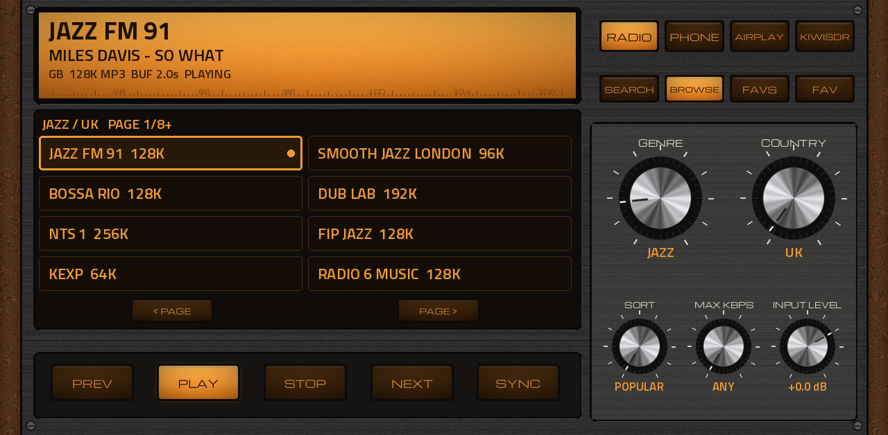
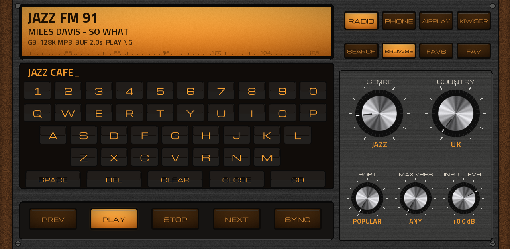
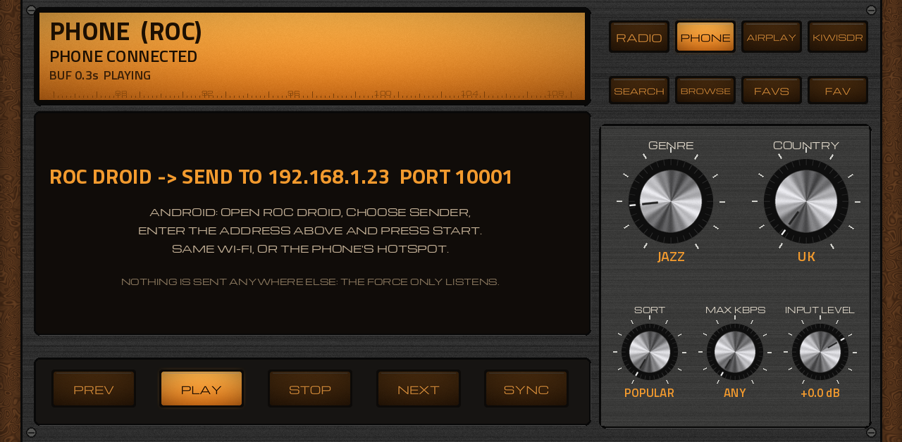
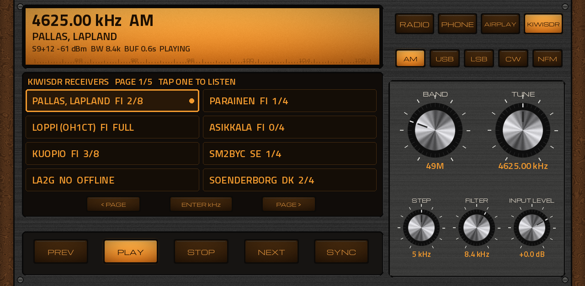

# Evil Tuner XXL

**Internet radio, shortwave, your phone and AirPlay, played straight into an Akai Force / MPC track, and bent out of shape on the way.**

Evil Tuner XXL is a native MPC OS VST2 instrument for the Akai Force and the standalone MPCs (Gen1, MPC OS 3.x). It
brings four sources into an MPC track:

- **RADIO**: 30,000+ internet stations from [Radio Browser](https://www.radio-browser.info), browsed by genre, country,
  popularity and bitrate, or searched by name;
- **PHONE**: any sound from an Android phone, sent over Wi-Fi with Roc (the open-source Roc Droid app);
- **AIRPLAY**: any sound from an iPhone, iPad or Mac, sent with AirPlay (nothing to install);
- **KIWISDR**: live shortwave, 10 kHz to 30 MHz, from public [KiwiSDR](http://kiwisdr.com) receivers around the world:
  broadcasters, hams, time signals, weather fax, beacons, tuned from the MPC.

Then it runs that sound through a granular voice, a filter, eleven character stages, a saturator, an Erica Synths-style
delay, plate / reverse / room reverb with shimmer, a 16-step trance gate, a stutter, a MIDI duck, a tempo-synced looper
with a rolling three-minute tape, and three LFOs. The plugin's track can be recorded or resampled like any other track on
the MPC.

The concept is inspired by the [Endorphin.es Evil Pet](https://endorphin.es) (a granular / effects box with a built-in
radio). Evil Tuner XXL is not affiliated with Endorphin.es and uses none of their code. It is not a model of their
hardware, only the idea of it.

| RADIO | PET |
|---|---|
|  |  |
| **FX** | **SPACE** |
|  |  |
| **GATE** | **TAPE** |
|  |  |
| **MOD** | **RADIO: search keyboard / PHONE** |
|  |   |
| **RADIO: KIWISDR** | |
|  | |

*The pages as the generator draws them (sample values). RADIO is the classic tuner: walnut, aluminium knobs, the amber
window and push buttons. The effect pages are the modern modules.*

---

## Contents

1. [Requirements](#requirements)
2. [Install](#install)
3. [Quick start](#quick-start)
4. [RADIO: playing stations](#radio-playing-stations)
5. [PHONE: Android with Roc](#phone-android-with-roc)
6. [AIRPLAY: iPhone, iPad, Mac](#airplay-iphone-ipad-mac)
7. [KIWISDR: shortwave from public receivers](#kiwisdr-shortwave-from-public-receivers)
8. [On the road: a phone hotspot](#on-the-road-a-phone-hotspot)
9. [PET: the grains](#pet-the-grains)
10. [FX: character, saturator, limiter](#fx-character-saturator-limiter)
11. [SPACE: Erica delay and reverb](#space-erica-delay-and-reverb)
12. [GATE: trance gate, stutter, duck](#gate-trance-gate-stutter-duck)
13. [TAPE: the rolling tape and the looper](#tape-the-rolling-tape-and-the-looper)
14. [MOD: LFOs, follower, envelope](#mod-lfos-follower-envelope)
15. [Pads and MIDI](#pads-and-midi)
16. [Recording into the MPC](#recording-into-the-mpc)
17. [Patch ideas](#patch-ideas)
18. [Privacy and network](#privacy-and-network)
19. [Troubleshooting](#troubleshooting)
20. [Building from source](#building-from-source)
21. [Credits and licences](#credits-and-licences)

---

## Requirements

- An **Akai Force** or a first-generation standalone MPC (MPC Live / Live II, One, X, Key 61) on **MPC OS 3.x**
  (32-bit ARM). The skin needs 3.x; it does not draw on 2.x.
- **Root shell (SSH)** to install, as with every catalog plugin: a modded unit (for example MockbaMod).
- A **network**: Wi-Fi, or a phone's hotspot. RADIO needs internet; PHONE and AIRPLAY only need the phone and the MPC on
  the same network.
- Nothing else. The decoders and receivers ship inside the plugin's folder (`bin/`), built fully static so they don't
  depend on the device's libraries. HTTPS uses MPC OS's own libcurl.

## Install

**With the Plugin Manager** (once Evil Tuner XXL is in the [mpc-vst-plugins catalog](https://sd88me.github.io/mpc-vst-plugins/)):
DISCOVER → Evil Tuner XXL → INSTALL → APPLY.

**One line, on the device** (needs internet; save your project first, MPC restarts):

```sh
cd /tmp && wget -qO et.zip https://github.com/sunskiefer/Evil-Tuner-XXL/releases/download/v0.1.0/Evil-Tuner-XXL-0.1.0-mpc-armv7.zip && unzip -qo et.zip && sh Evil-Tuner-XXL-0.1.0/install.sh
```

**From a computer:** download the release zip, then

```sh
scp -r Evil-Tuner-XXL-0.1.0 root@<device-ip>:/tmp/
ssh root@<device-ip> sh /tmp/Evil-Tuner-XXL-0.1.0/install.sh
```

The installer checks the device, copies the plugin folder to `/sdcard/Synths/`, backs up `MPC.settings`, registers the
plugin and restarts MPC. Running it again upgrades and keeps your favourites. `uninstall.sh` removes it. The generated
`INSTALL.md` inside the zip has the manual steps.

Then add **Evil Tuner XXL** to a track from the plugin browser (**Instrument** plugins). Seven pages appear: **RADIO, PET,
FX, SPACE, GATE, TAPE, MOD**. The Q-Links follow the page.

## Quick start

1. Add the plugin to a track. RADIO opens and lists the most-played stations in the world.
2. Turn **GENRE** (say JAZZ) and **COUNTRY** (say UK): half a second later the list follows.
3. Tap a station. **PLAY** blinks while it connects, then stays lit. The amber window shows the station, the song (when
   the station sends titles) and the buffer.
4. Go to **PET** and turn up **GRAIN MIX**: the radio turns into grains. Turn **POSITION**, **SIZE**, **PITCH**.
5. Go to **SPACE**, turn up **DRY/WET** on the delay and **VERB MIX**. Go to **GATE**, press **GATE ON**.
6. Record or resample the track ([Recording into the MPC](#recording-into-the-mpc)).

Everything about the sound (knobs, switches, gate steps, the last station) is saved with the project and with MPC
presets. A station is never played on its own when a project loads: press **PLAY**.

---

## RADIO: playing stations


**The amber window**: station name; now playing (the station's own titles, when it sends them), or the state; the
country, bitrate, codec, the seconds of audio buffered and the state (CONNECTING, BUFFERING, PLAYING, WAITING FOR PLAY,
STOPPED, ERROR).

**Sources** (top right): **RADIO**, **PHONE**, **AIRPLAY**, **KIWISDR**. One at a time.

**The list**: eight stations per page, with their bitrate. Tap one to play it; the one on air is lit, with a lamp.
**< PAGE** and **PAGE >** move through the list. Paging past what is loaded fetches the next 64 stations. The line above
the list says what you are looking at (GENRE / COUNTRY, a search, or your favourites) and the page.

**What the list shows**:

| Key | |
|---|---|
| **BROWSE** | stations by the four knobs: **GENRE** (70 styles, or ALL), **COUNTRY** (70 countries, or ALL), **SORT**, **MAX KBPS** |
| **SEARCH** | opens the keyboard: type part of a name ("fip", "kexp", "jazz cafe") and press **GO**. If no station name matches, the words are tried as a style. **DEL** deletes a letter, **CLEAR** everything, **CLOSE** goes back to the list. GO with nothing typed goes back to browsing. |
| **FAVS** | your favourites, kept on the device (they work offline and survive upgrades) |
| **FAV** | adds the station playing to the favourites, or takes it out (lit when it is a favourite) |

**SORT**: POPULAR (most played), VOTES (most liked), TRENDING (played more lately), NAME, BITRATE, RANDOM (a different
handful each time: good for discovering).

**MAX KBPS**: ANY, or a ceiling (64K .. 320K). On a phone's mobile data, 64K or 96K keeps the data use down: a 128K
station uses about 58 MB an hour, a 64K one about 29 MB.

**Transport**: **PREV** / **NEXT** play the station before / after in the list; **PLAY** plays the last station again (or the
first of the page); **STOP** stops and ends the connection.

**SYNC**: for resampling in time. With SYNC lit, a station you tap connects and fills its buffer silently (PLAY blinks
slowly, the window says WAITING FOR PLAY) and starts the moment you press **Play** on the MPC. The buffer is trimmed as it
starts, so the radio begins on your downbeat.

**INPUT LEVEL**: the source's level into everything else (the radio, the phone or AirPlay). 0 dB at its middle mark.

**Buffering**: a station keeps about two seconds of audio in hand, so a Wi-Fi hiccup doesn't stop it. If the network
drops, the plugin reconnects by itself (up to six times) and says RECONNECTING. The buffer follows the station's clock
very slowly (at most 0.2 %), so it never drifts out.

**What plays**: MP3, AAC / AAC+, Ogg Vorbis, Opus and FLAC streams, over http and https, including stations whose link is
a `.pls` / `.m3u` playlist. Stations that only stream HLS (`.m3u8`) are left out of the list.

## PHONE: Android with Roc

PHONE turns the MPC into a receiver for **Roc**, an open-source protocol for sending audio over a local network (RTP with
error correction, so a little Wi-Fi loss doesn't click). Any Android app's sound (Spotify, YouTube, a field recorder, a
synth app) or the phone's microphone can play into the MPC.

**1. Get Roc Droid on the phone** (free and open source, no account, no ads):
- from **F-Droid**: search "Roc Droid" ([f-droid.org/packages/org.rocstreaming.rocdroid](https://f-droid.org/en/packages/org.rocstreaming.rocdroid/)), or
- the APK from **GitHub**: [github.com/roc-streaming/roc-droid/releases](https://github.com/roc-streaming/roc-droid/releases)
  (download the `.apk` on the phone, open it, allow installing from your browser when Android asks).

**2. Join the same network**: the phone and the MPC on the same Wi-Fi, or the MPC joined to the phone's hotspot.

**3. On the MPC**: press **PHONE** on the RADIO page. The window says WAITING FOR THE PHONE, and the page shows the MPC's
address, for example `ROC DROID -> SEND TO 192.168.1.23  PORT 10001`.

**4. In Roc Droid**: open the **sender** side, enter that address as the receiver's IP (the ports are Roc's defaults: 10001
for audio, 10002 for repair, nothing to change), choose what to send (the phone's apps, or its microphone) and press
start. Android asks once whether Roc Droid may capture or record audio: allow it.

**5.** Play something on the phone. The window says PHONE CONNECTED and the sound arrives a quarter of a second later.

Notes:
- Sending other apps' sound needs Android 10 or newer. Some apps don't allow their sound to be captured; the microphone
  always works.
- The phone's own volume doesn't matter much: **INPUT LEVEL** sets the level on the MPC.
- When the phone stops sending, the MPC goes quiet and waits; start again any time. PHONE stays ready in the project:
  reopening the project starts the receiver again.
- An "Evil Tuner XXL" companion app (Roc Droid renamed and simplified, finding the MPC by itself) may follow; Roc
  Droid works today.

## AIRPLAY: iPhone, iPad, Mac

Nothing to install: the MPC appears in Apple's own AirPlay list.

1. The iPhone and the MPC on the same Wi-Fi (or the MPC on the iPhone's hotspot: see [the next section](#on-the-road-a-phone-hotspot)).
2. On the MPC press **AIRPLAY**: the window says WAITING FOR AIRPLAY.
3. On the iPhone: **Control Centre** → the music player's **AirPlay** icon → **Evil Tuner XXL**. In an app: its AirPlay
   button. On a Mac: Control Centre → Sound → **Evil Tuner XXL**.
4. Play. The window shows the artist and title the iPhone sends.

This is classic AirPlay (AirPlay 1) audio, the same thing that works with older speakers; any app that can AirPlay
audio can use it. The iPhone's volume slider is ignored on purpose: **INPUT LEVEL** sets the level. AirPlay adds a short
delay (Apple's own buffer, about two seconds), so it's for playing material in, not for live playing on the phone.

## KIWISDR: shortwave from public receivers


A [KiwiSDR](http://kiwisdr.com) is a shortwave receiver (10 kHz to 30 MHz) that its owner shares on the internet, usually
four or eight listeners at a time. Hundreds are public. KIWISDR plays one of them into the track: you pick the receiver
and the frequency, the receiver demodulates and sends the audio (about 12 kHz wide, mono on both channels).

1. Press **KIWISDR** (top right). The list shows receivers, eight per page: the name, the country and, once asked, how
   many listen (**2/8**), **FULL** or **OFFLINE**. **< PAGE** / **PAGE >** go through the list.
2. Tap a receiver: it connects and plays. **PREV** / **NEXT** go to the receiver before / after; **STOP** ends the session.
3. Tune with the knobs (they take the RADIO page's genre and country places; Q-Link page **RADIO 2** has them too):

| Knob | |
|---|---|
| **BAND** | a jump: LF, LW, MW, the broadcast bands **120M** to **11M**, the ham bands **160M** to **10M**, **CB**, **NDB** beacons, and three lists: **TIME SIGNALS**, **VOLMET** (aviation weather), **WEATHER FAX**. A band sets its usual mode, a busy frequency and its step. |
| **TUNE** | an endless knob over the whole 0 .. 30 MHz: one STEP per detent, either way, as far as you like (bands are only starting points); a fast spin or a drag moves several steps. In a list band it goes from entry to entry. |
| **STEP** | how far a TUNE detent goes: 10 Hz, 100 Hz, 500 Hz, 1, 5, 9, 10, 100 kHz, 1 MHz (10 or 100 Hz for SSB voices that sound like ducks) |
| **FILTER** | the bandwidth, within the mode's range (AM 3..12 kHz, SSB 1.5..3.6 kHz, CW 100..1000 Hz, NFM 6..12 kHz) |

**ENTER kHz** (between the page keys) opens the keyboard for a frequency: type it in kHz (`4625`; SPACE is the decimal
point: `6075 2` = 6075.2) and press **GO**.

The mode keys (in the second row in KIWISDR): **AM**, **USB**, **LSB**, **CW**, **NFM**. The window shows the frequency and
mode, the receiver, the S-meter and dBm, the bandwidth and the buffer. Tuning goes to the receiver at once; you hear it
about half a second later (the buffer that keeps the internet's hiccups out).

**Your own receivers**: `kiwisdr.txt` in the plugin's `user_data/` folder (made on first use, with examples) lists yours
first: one per line, the address as the browser shows it and a name (`http://my-kiwi.example.org:8073 MY RECEIVER`).
Plain http only. Find receivers at [kiwisdr.com/public](http://kiwisdr.com/public/) or
[receiverbook.de](https://www.receiverbook.de). Reopen the plugin after editing.

**Manners**: a receiver's slots are shared by everyone. The session ends with STOP, another source or another receiver,
and it is never reopened by itself after the receiver ended it (receivers have time and inactivity limits; when it says
THE RECEIVER ENDED THE SESSION, pick another or press PLAY later). Only a dropped network is retried, three times. The
list asks only the receivers on screen for their status, at most every five minutes each. On a phone's mobile data a
session uses about 22 MB an hour.

## On the road: a phone hotspot

A phone's hotspot **is** a Wi-Fi network, with the phone as its router: join the MPC to it (MPC Preferences → Wi-Fi) and
everything works as at home.

- **RADIO** uses the phone's mobile data. Use **MAX KBPS** to stay on light streams. **KIWISDR** uses about 22 MB an hour.
- **PHONE (Roc)**: the hotspot phone sends to the MPC's address on the hotspot network (the page shows it). Works.
- **AIRPLAY from the iPhone that is also the hotspot**: whether iOS lists AirPlay receivers on its own hotspot hasn't been
  confirmed on a device yet. If Evil Tuner XXL doesn't appear, use another device's hotspot, or a Wi-Fi network.

## PET: the grains


The granular voice reads a buffer that always holds the last **8 seconds** of the source (or a frozen picture of it).
It is off until **GRAIN MIX** is turned up.

| Knob | |
|---|---|
| **POSITION** | how far back in the 8 s the grains read (0 = just now; turn up to read further back, or across a frozen buffer) |
| **SIZE** | grain length, 8 ms .. 1 s |
| **PITCH** | ±24 semitones (a detent at 0) |
| **GRAINS** | how many grains a second, 1.5 .. 90 |
| **SPREAD** | scatters the read position (up to 1 s) and pans grains across the stereo field |
| **CLOUD** | chaos: irregular timing, grains an octave up or down, grains played backwards |
| **DETUNE** | each grain slightly out of tune (up to ±½ semitone): chorus to smear |
| **SHAPE** | the grains' envelope: percussive (left), smooth (middle), reversed swells (right) |
| **CUTOFF**, **RESONANCE** | the filter (type: the keys below) |
| **FILTER ENV** | moves the cutoff with an envelope, up (right) or down (left): with KEYS, the notes' envelope; without, the source's level (an auto-wah) |
| **OSC LEVEL** | the oscillator layer played by the KEYS notes (key **OSC** chooses its wave) |
| **GRAIN MIX** | the source against the grains |
| **VOLUME** | the plugin's output (0 dB at its middle mark) |

| Key | |
|---|---|
| **FREEZE** | stops the buffer: the grains play the last 8 s over and over while the radio goes on |
| **KEYS** | the pads / a keyboard play the grains (eight voices, pitched from C3 = no transposition, with the MOD page's envelope); off, the grains run on their own (a drone) |
| **LP HP BP COMB DUAL** | the filter. COMB: a resonant comb tuned by CUTOFF (metallic, pitched). DUAL: one knob DJ filter, open in the middle, low-pass to the left, high-pass to the right |
| **OSC** | the oscillator's wave: sine, triangle, saw, square (lit while OSC LEVEL is up) |
| **RANDOM** | new grain and filter settings (not GRAIN MIX or VOLUME), like the Evil Pet's random button |

## FX: character, saturator, limiter


**CHARACTER** (Loop Saboteur's output stages, by clickysteve): **CASSETTE** (wow, flutter, hiss), **REEL** (slow wow,
head bump), **DAMAGED** (dropouts, deep wobble), **VINYL** (crackle, wobble), **BOOMBOX**, **AM RADIO** (narrow band,
static), **VHS HI-FI** (pumping), **BUS COMP** (glue, no noise), **LATHE** (dub-plate emphasis), **PHONE** (voicemail).
**INTENSITY** how hard, **CHAR MIX** wet/dry. **CHAR ON** switches it, **CHAR PRE** puts it before the grains instead of
after the filter (the grains then chop the coloured sound).

**SATURATOR**: **TAPE** (soft), **TUBE** (warm, asymmetric), **DIODE** (hard clip), **FUZZ** (broken speaker), **CRUSH**
(16 → 2 bits), **DOWNSAMPLE** (sample-and-hold), **FLANGER** (AMOUNT = feedback), **CHORUS** (AMOUNT = depth).
**SAT AMOUNT**, **SAT MIX**, **SAT ON**.

**LIMITER**: a look-ahead brickwall at the end of the chain. **LIMIT DRIVE** pushes into it (up to +18 dB), **CEILING**
is the most it lets out (-12 .. -0.3 dB). On by default: shimmer and feedback can't blow up the track.

## SPACE: Erica delay and reverb


**ERICA DELAY** (from LXRXXL BAZZLINE, written to behave as the Erica Synths DIY Delay's manual describes; not Erica's
code): **DELAY TIME** up to 800 ms, or with **SYNC** a fraction or multiple of the beat; **DELAY IN LVL**; **FEEDBACK**
(self-oscillates at the top); **DRY/WET**. **TAPE/DIGI**: TAPE bends the pitch when the time moves and darkens the
repeats; DIGITAL crossfades to a new time. **HOLD** loops what is in the delay; **ADD** layers new sound onto the held
loop; **REVERSE** plays the repeats backwards. **DELAY ON** switches it.

**REVERB** (Dragonfly Reverb's Plate and Room, by Michael Willis): **PLATE**; **REVERSE** (the plate's tail cut into
one-beat pieces played backwards: swells into each beat); **ROOM**. **DECAY** 0.3 .. 8 s, **SHIMMER** feeds the tail back
an octave up, **VERB MIX**, **VERB ON**.

## GATE: trance gate, stutter, duck


**The 16 steps**: tap to switch a step on or off (the running step blinks). Editing a step sets **PATTERN** to USER.
**PATTERN** loads a pattern into the steps (STRAIGHT, OFFBEAT, TRANCE 1, TRANCE 2, GALLOP, SYNCOPATE, BROKEN, 3-3-2,
STUTTER, HALF) or RANDOM (a new pattern every bar). **GATE RATE**: the length of a step, a whole note .. a 1/32 note
(1/16 = the classic trance gate). **GATE DEPTH**: how far an off step goes down. **GATE ATTACK** / **GATE RELEASE**: soft pumping to
hard chop. **SWING** delays the odd steps. The gate follows the MPC's bar while it plays (its own count otherwise).
**GATE ON** switches it.

**STUTTER**: repeats the last slice (**STUTTER LEN**: a 1/4 note .. a 1/64 note) until pressed again. The pads do it while held
(see [Pads](#pads-and-midi)): the DJ-roll way.

**DUCK**: a note on **DUCK MIDI CH** ducks the sound by **DUCK DEPTH**, back in **DUCK RELEASE**. Send a kick track's MIDI
to that channel and the radio pumps with the beat. **DUCK ON** switches it. (Notes on that channel only duck: they don't
play grains.)

## TAPE: the rolling tape and the looper


The **tape** always records the last **3 minutes** of the source (after INPUT LEVEL), whatever you do. Heard something good?
It's already on tape.

| Key | |
|---|---|
| **CAPTURE** | the last **LOOP LENGTH** of the tape becomes the loop and plays (FREE: the last two bars) |
| **REC** | empty: records a loop from now (LOOP LENGTH, or FREE until REC again). While a loop plays: overdub on / off |
| **PLAY**, **STOP** | the loop |
| **REVERSE**, **HALF**, **DOUBLE** | direction, half speed, double speed |
| **CLEAR**, **UNDO** | UNDO brings back the loop before the last capture, overdub, render or clear |
| **TO GRAINS** | the loop becomes the grains' buffer (frozen): PET plays the loop |
| **RENDER** | renders the loop through **STRETCH** in the background (RENDER blinks), then plays the result |

| Knob | |
|---|---|
| **LOOP LENGTH** | FREE, 1/4 bar .. 8 bars, at the MPC's tempo |
| **LOOP START** | where in the loop it starts (rotates it) |
| **LOOP SPEED** | ±1 octave, varispeed (a detent at x1.00) |
| **LOOP LEVEL** | the loop's level |
| **OVERDUB FB** | how much of the old loop each overdub pass keeps |
| **LIVE/LOOP** | 0: the live source plus the loop; up: the live source fades out, leaving the loop |
| **STRETCH** | PAULSTRETCH (2x .. 10x longer, smeared into pads), FREEZE (one moment held as a drone the loop's length), STUTTER (chunks repeated), CLOUD (scattered grains), HALF TAPE (an octave down, twice as long), REVERSE |
| **STRETCH AMT** | the amount (PAULSTRETCH: how much longer; FREEZE: where in the loop) |

The window above shows the tape's length, the loop's length in seconds and beats, and its state.

## MOD: LFOs, follower, envelope


**Three LFOs**: **RATE** (0.02 .. 20 Hz, or with **SYNC** 4 bars .. 1/16 and triplets, locked to the MPC's bar), **DEPTH**,
**WAVE** (sine, triangle, saw up, saw down, square, S&H, drift) and **DEST**. **The follower**: the source's level as a
modulator: **FOLLOW AMT**, **FOLLOW SPEED**, **FOLLOW DEST**. The destinations: POSITION, SIZE, PITCH, GRAINS, SPREAD, CLOUD,
DETUNE, SHAPE, CUTOFF, RESONANCE, GRAIN MIX, CHAR INT, SAT AMOUNT, DELAY TIME, DELAY FB, DELAY WET, VERB MIX, GATE DEPTH,
LOOP SPEED, VOLUME. Modulation moves around the knob's own position.

**The keys' envelope** (KEYS mode): **ATTACK**, **DECAY**, **SUSTAIN**, **RELEASE** for the grain voices and the oscillator.

## Pads and MIDI

The plugin's track takes MIDI from the pads, a keyboard or a sequence.

**KEYS on**: every note plays a grain voice (eight voices; C3 = the source's pitch) and the oscillator.

**KEYS off**: the pads are performance controls:

| Note | While held |
|---|---|
| 36 (C1) | stutter, a 1/4 note |
| 37 (C#1) | stutter, 1/8 |
| 38 (D1) | stutter, 1/16 |
| 39 (D#1) | stutter, 1/32 |
| 40 (E1) | freeze the grains |
| 41 (F1) | CAPTURE (on the press) |
| 42 (F#1) | delay HOLD |
| 43 (G1) | the trance gate |

Set the pads to play notes 36–43 (the usual first eight pads of bank A).

Notes on **DUCK MIDI CH** (with DUCK ON) only trigger the duck. A program change or CC does nothing; everything else is on
the Q-Links (each page has its own: RADIO 1–2, PET 1–2, FX, SPACE, GATE, TAPE, MOD 1–3).

## Recording into the MPC

The plugin is a normal track, so any of the MPC's ways of recording works:

- **Resample** (Force: the sampler with its input on Resample / the master, or MPC: Sampler → Input: Resample). Set
  **SYNC** on the RADIO page, arm the sampler, press Play: the radio starts with the sequence.
- **An audio track** whose input is the Evil Tuner XXL track: record it like a performance, with the gate and the stutter
  played live.
- **The TAPE page** first: capture the best moment into the loop, stretch it, then resample the loop.

Respect the stations' rights: radio is for sketching, sampling for your own music, and performance. Check before releasing
music with recognisable material in it.

## Patch ideas

Start from the defaults (a new instance), then:

1. **Shortwave ghost.** A talk station (GENRE: NEWS or TALK, a country you don't speak). CHARACTER AM RADIO, INTENSITY
   80%; SAT DOWNSAMPLE 40%; GRAIN MIX 40%, SIZE 60%, CLOUD 30%; VERB REVERSE, VERB MIX 35%.
2. **Ambient freeze pad.** Any station with sustained music. FREEZE on; GRAIN MIX 100%; SIZE 90%, GRAINS 80%, SPREAD 70%,
   DETUNE 30%, SHAPE middle; VERB PLATE, DECAY 6 s, SHIMMER 40%, VERB MIX 50%. LFO1 → POSITION, SINE, 0.05 Hz, DEPTH 40%.
3. **Trance-gated radio.** A dance station. GATE ON, PATTERN TRANCE 1, RATE 1/16, ATTACK 2 ms, RELEASE 60 ms; DUAL filter
   swept by LFO2 (SYNC 1 BAR, TRI, DEST CUTOFF, DEPTH 50%); delay SYNC, 1/2 beat, DRY/WET 25%.
4. **Pumping dub.** Reggae or dub (GENRE DUB). DUCK ON from your kick track's channel, DEPTH 70%; delay TAPE, SYNC,
   FEEDBACK 70%, DRY/WET 40%; press **HOLD** on a vocal and **ADD** to stack it; CHARACTER REEL.
5. **Pitched grain keys.** KEYS on; a choir or strings station, FREEZE on a chord; SIZE 50%, GRAINS 70%, SHAPE smooth;
   OSC LEVEL 20% (SAW) under it; ATTACK 300 ms, RELEASE 2 s. Play chords on the pads.
6. **Paulstretch bed.** Find a phrase, TAPE: LOOP LENGTH 1 BAR, CAPTURE, STRETCH PAULSTRETCH, STRETCH AMT 60%, RENDER.
   LIVE/LOOP 100%, then TO GRAINS for a granular version of the stretched phrase.
7. **Broken cassette mixtape.** CHARACTER DAMAGED, INTENSITY 70%; SAT TAPE 50%; LFO3 S&H → PITCH, DEPTH 6%, 4 Hz; GATE
   RANDOM pattern, DEPTH 40%.
8. **Phone field recorder.** PHONE source, Roc Droid sending the microphone. COMB filter tuned with CUTOFF to your track's
   key, RESONANCE 70%; FOLLOWER → GRAIN MIX (AMT 60%): the louder you are, the more it turns to grains.
9. **Stutter performance.** KEYS off; hold notes 36–39 for rolls on the beat, 42 to freeze the delay, 43 for the gate.
   Record it to an audio track.
10. **Reverse swell transitions.** VERB REVERSE, DECAY 3 s, VERB MIX 60%; delay REVERSE, DRY/WET 30%; automate VERB MIX on
    the last bar before a drop.
11. **Lo-fi vinyl loop.** A soul / funk station; CAPTURE 2 BARS; CHARACTER VINYL; SAT CRUSH 30%; LOOP SPEED x0.89 (a minor
    third down); LIVE/LOOP 100%.
12. **AirPlay remix desk.** AIRPLAY from the iPhone's music app; DUAL filter on a Q-Link; GATE OFFBEAT for the breakdown;
    TAPE CAPTURE + REVERSE for fills.

## Privacy and network

- **RADIO** talks to Radio Browser (a free, community-run directory: a search, and a "this station was played" count, as
  their guidelines ask; no account, no personal data) and to the station itself. Nothing else.
- **PHONE** and **AIRPLAY** only **listen** on the local network (Roc: UDP 10001–10003; AirPlay: TCP 5000, UDP 6001 and up,
  mDNS 5353 to appear in the AirPlay list). Nothing is sent anywhere. Roc Droid is open source with no tracking code; the
  MPC's address never leaves the local network.
- **KIWISDR** talks to the receiver you pick (its WebSocket on the receiver's own port, usually 8073: the commands for
  frequency and mode, a keepalive once a second; it shows "EvilTunerXXL" as the listener's name in the receiver's user
  list), and to the receivers on screen for their `/status` page. The receiver sees the MPC's internet address, as it
  does any listener's. Nothing else.
- The receivers stop when you switch source or close the plugin, and they are tied to the plugin: if MPC quits, they quit.

## Troubleshooting

| What you see | What to do |
|---|---|
| NO CONNECTION TO RADIO-BROWSER.INFO | The MPC has no internet: check Wi-Fi / the hotspot. Press BROWSE to try again. |
| A station shows STATION ERROR or CAN'T DECODE | That station is down or uses an unusual format: press NEXT. |
| RECONNECTING | The network dropped; it comes back by itself. |
| PHONE: nothing arrives | Same network? The address in Roc Droid exactly as the page shows it? Some public / hotel Wi-Fi blocks devices from talking to each other: use a phone hotspot. |
| PHONE RECEIVER STOPPED (PORT IN USE?) | Another plugin instance has PHONE on: one PHONE receiver per MPC. |
| AIRPLAY: the MPC isn't in the list | Same network? Wait ten seconds after pressing AIRPLAY. Some routers block AirPlay discovery between devices. |
| KIWISDR: RECEIVER FULL | All its listener slots are taken: pick another (the list shows FULL once it has asked). |
| KIWISDR: THE RECEIVER ENDED THE SESSION | Its time or inactivity limit: pick another receiver, or press PLAY again later. |
| KIWISDR: ONE CONNECTION PER ADDRESS | The receiver allows one listener per internet address and someone on your network (a browser tab?) uses it. |
| KIWISDR: a receiver OFFLINE, or CAN'T FIND / DOESN'T ANSWER | Owners move or retire receivers: pick another, or add your own in `kiwisdr.txt`. |
| No sound with GRAIN MIX up | FREEZE on an empty buffer: turn FREEZE off for a few seconds. |
| The sound is too loud / clipping | The LIMITER is on by default; lower VOLUME or INPUT LEVEL. |

Logs on the device (for a bug report): `/tmp/eviltuner.log`, and `/tmp/eviltuner-ffmpeg.log`, `-roc.log`, `-airplay.log`.
Favourites, your KiwiSDR list and settings: `user_data/` inside the plugin's folder (the installer keeps it on upgrades).

## Building from source

Needs Linux, python3 (Pillow, numpy, scipy), gcc, and Zig (`pip install ziglang`), or instead of Zig an
arm-linux-gnueabihf GCC with a glibc 2.31 sysroot (`ARM_GCC=<path>/<triple>- ./build.sh`, e.g.
[tttapa/docker-arm-cross-toolchain](https://github.com/tttapa/docker-arm-cross-toolchain)'s `armv6-rpi-linux-gnueabihf`);
for the helpers also git, make, autotools, cmake, scons, ragel, pkg-config and llvm (`llvm-strip`, `llvm-objcopy`).

```sh
helpers/build_helpers.sh   # once: ffmpeg, et_roc, shairport-sync (static, armv7), from fixed tags on GitHub
./build.sh                 # the plugin (armv7, glibc 2.31) and its skin -> build/package/
test/run_tests.sh          # offline tests on x86 under ASan / UBSan (a local stream through the real radio path,
                           # a stand-in KiwiSDR receiver through the real KIWISDR path)
python3 tools/preview.py out/   # the pages as pictures
```

`tools/gen_params.py` is the parameter list, `tools/panel.py` where everything sits, `tools/panel_art.py` draws the pages.
Final artwork drops in as `art/bg/<PAGE>.png` (1280 x 628): the generated background is then replaced and the controls are
drawn over it.

Status of 0.1.0: tested offline (the engine and wrapper on x86 under ASan / UBSan; the ARM build loaded and run under QEMU;
the radio path end to end with a local stream; the ARM Roc receiver with a Roc sender; MP3, AAC and Ogg through the ARM
decoder; the ARM AirPlay receiver starting). **Not yet tested on a device.**

Status of 0.2.0 (KIWISDR): the protocol checked against a live receiver from a browser (the commands, the MSG and SND
messages, the ADPCM decoder's state carried over, matching the uncompressed stream's level); the engine on x86 against a
stand-in receiver (pitch follows the tuning through ADPCM and plain blocks, a full receiver, a session the receiver
ends, a stalled network); the ARM build checked for its target (armv7, VFPv3-D16, no NEON, glibc 2.29 at most). **Not yet
tested on a device.**

## Credits and licences

- Developer: **L'Cronx** (L'Cronx). Knobs and keys from the LXRXXL / LXRXXL BAZZLINE artwork by **Suns Kiefer**. Build:
  Claude.
- Concept inspired by the **Endorphin.es Evil Pet**; no affiliation, no code.
- **Loop Saboteur** output stages (`OutputStage.h`) by Stephen McLeod Blythe / clickysteve, GPL-3.0; the drive shapes after
  **The Good Bits** (clickysteve, MIT).
- **Dragonfly Reverb** (Plate, Room) by Michael Willis and contributors, GPL-3.0, with freeverb3 (GPL).
- The delay and the duck from **LXRXXL BAZZLINE**; the limiter from **RMXXXL**.
- **mpc-vst-plugins** (sd88me): the VST2 wrapper, skin and release tools, MIT.
- Helpers, each a separate program in `bin/`: **FFmpeg** 7.1.2 (LGPL-2.1+, decoders only), **roc-toolkit** 0.3.0 (MPL-2.0,
  with libuv MIT and OpenFEC CeCILL-C), **shairport-sync** 4.3.7 (MIT, with mbedTLS Apache-2.0, libconfig LGPL-2.1,
  popt MIT). Their sources: the tags in `helpers/build_helpers.sh`.
- Stations: **Radio Browser** (radio-browser.info), a community directory. Each station's stream belongs to its owner.
- **KiwiSDR** (John Seamons, jks-prv, kiwisdr.com): the receivers and their open protocol, as its open-source client
  **kiwiclient** speaks it; no code taken. Each receiver belongs to its owner, who shares it.
- Fonts: Michroma and Titillium Web (SIL OFL 1.1).

Evil Tuner XXL is free software under the **GNU GPL v3.0 or later** (see `LICENSE`).
